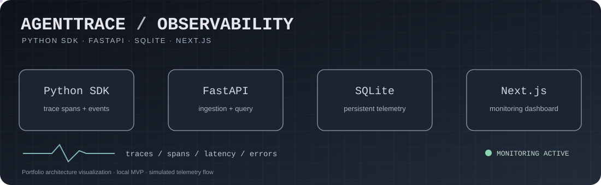

  

  <a href="https://github.com/marcellabongiolo/AgentTrace">AgentTrace</a> ·
  <a href="https://github.com/marcellabongiolo/fintrack">FinTrack</a> ·
  <a href="https://github.com/marcellabongiolo/swiss-company-intelligence">Swiss Company Intelligence</a> ·
  <a href="https://github.com/marcellabongiolo/SLADeck">SLADeck</a> ·
  <a href="https://github.com/marcellabongiolo/ai-4d">AI 4D</a>

# Marcella Bongiolo

**Aspiring Software Engineer · Python · Full-Stack Projects · Testing & Architecture**

I build and document software projects to turn engineering concepts into working systems. My portfolio includes an **AI-agent observability platform**, a **personal finance application**, and experiments in **data analysis, operations workflows, and interactive visualization**.

I'm developing my skills through hands-on implementation, automated tests, documentation, and iterative improvements. These are **personal and educational projects**, not claims of professional industry experience.

## Current Focus

- **Programming fundamentals:** Python, algorithms, data structures, and SQL
- **Application development:** JavaScript/TypeScript, React, APIs, and databases
- **Software quality:** unit and integration tests, Git, code reviews, and CI
- **Systems thinking:** architecture, observability, cloud, and platform engineering

My approach is to **build → test → document → improve**.

## Technologies & Concepts I'm Exploring

  

**Used in portfolio projects:** Python, JavaScript/TypeScript, React/Next.js, FastAPI, HTML/CSS, SQLite, Git, and GitHub Actions.

**Currently strengthening:** algorithms, SQL, object-oriented design, automated testing, code quality, and CI/CD.

**Exploring next:** cloud infrastructure, platform engineering, distributed systems, and AI systems.

*The icons above represent technologies I use or study—not a claim of expert proficiency.*

## Interactive Engineering Universe

Explore my projects in a futuristic, animated 3D-inspired interface: **[Open Marcella's Engineering Universe](https://marcellabongiolo.github.io/Marcellabongiolo/)**.

  

## Projects

A selection of hands-on projects, with links to their code, documentation, and available demos. Each project highlights a different engineering challenge.

### Featured engineering project · AgentTrace

  

**[Explore AgentTrace](https://github.com/marcellabongiolo/AgentTrace)** — my featured end-to-end engineering project.

- **Instrumentation:** Python SDK records structured traces, spans, events, and errors.
- **Backend and data:** FastAPI ingestion/query endpoints with SQLite persistence.
- **Interface:** Next.js/TypeScript dashboard for filtering and inspecting traces.
- **Quality:** automated Python and React tests, linting, CI, and Docker-based local setup.

**Status:** completed local portfolio MVP; the animation illustrates the architecture rather than a live hosted service.

### Selected implemented projects

| Project | What to review |
|---|---|
| [FinTrack](https://github.com/marcellabongiolo/fintrack) | React/TypeScript finance interface with transaction management and tests. [Live demo](https://marcellabongiolo.github.io/fintrack/). |
| [Swiss Company Intelligence](https://github.com/marcellabongiolo/swiss-company-intelligence) | Explainable screening pipeline and Streamlit dashboard using synthetic demo data. |
| [SLADeck](https://github.com/marcellabongiolo/SLADeck) | Local multi-tenant operations MVP with tested account onboarding, SLA policies and request workflows. |
| [AI 4D](https://github.com/marcellabongiolo/ai-4d) | Interactive geometry visualization and experimental temporal-analysis API. |

[Visit my portfolio](https://marcellabongiolo.github.io/portfolio-app/). Small exercises and forks are supplementary learning material; a fork by itself is not evidence of an original implementation.

### Planetary Weight Calculator · Python

  

Explore the [Planetary Weight Calculator](https://github.com/marcellabongiolo/peso_planetas.py), a Python exercise that calculates weight equivalents across Solar System bodies. The animation is a visual illustration of the project.

### NEXUS — Intelligent Systems Lab

An interactive personal laboratory exploring **software engineering, artificial intelligence, cloud computing and system architecture**.

[Explore NEXUS](./projects/nexus-intelligent-systems/)

## Engineering Approach

I use GitHub as a technical portfolio and learning laboratory. Across projects, I focus on:

- **Readable code:** clear structure, naming, and documentation.
- **Verification:** automated tests and reproducible local instructions.
- **Iteration:** issues, branches, pull requests, and incremental improvements.
- **Honest scope:** distinguishing working local MVPs, public demos, and experiments.

## What's Next

I'm continuing to strengthen software engineering fundamentals while exploring **cloud, platform engineering, scalable systems, and observability**.

## GitHub Activity

  
  

For an up-to-date view of my work, see my [contribution history](https://github.com/marcellabongiolo?tab=overview) and [repositories](https://github.com/marcellabongiolo?tab=repositories). These links use GitHub's own pages instead of potentially unreliable third-party statistics images.

## Contact

  
  
  

---

> I'm still learning — and that's exactly why I'm building.
